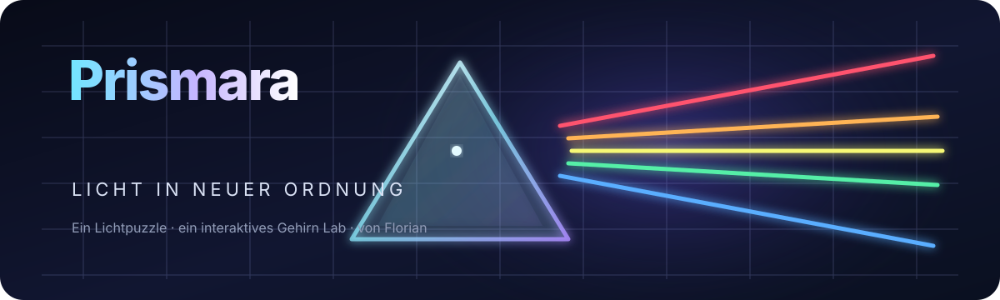

  
    
  <strong>LICHTPUZZLE</strong>
  &nbsp;·&nbsp;
  <strong>INTERAKTIVE PROJEKTKARTE</strong>
  &nbsp;·&nbsp;
  <strong>VON FLORIAN</strong>

## Prismara

Prismara verbindet ein farbiges Lichtpuzzle mit einer interaktiven Karte, die den Aufbau des Projekts sichtbar macht. Lenke Licht durch Spiegel und Prismen, löse Level und entdecke anschließend, wie die Spielteile miteinander verbunden sind. Ein eigenständiges Browserprojekt, das Spielmechanik und Projektübersicht an einem Ort zusammenführt.

### Im Projekt

- **Lichtpuzzle:** Level mit Spiegeln, Prismen, Zielen und farbigen Lichtstrahlen.
- **Gehirn Lab:** Projektknoten als Karte oder Liste erkunden, filtern, einfärben und anordnen.
- **Wachstumsansicht:** Verbindungen und Knotennamen nacheinander verfolgen.
- **Browserbasiert:** Das Spiel und die Projektkarte laufen ohne Installation im Browser.

### Aufbau

| Ordner | Aufgabe |
| --- | --- |
| `src/game/` | Spielregeln, Spielfortschritt und Darstellung |
| `src/ui/` | Startseite, Menüs und Spieloberfläche |
| `src/lab/` | Interaktive Gehirnkarte und Projektübersicht |
| `lab/` | Gespeicherte Knoten, Verbindungen und Projektwissen |
| `assets/` | Prismara-Symbol und GitHub-Banner |

### Lokal ansehen

Das Projekt besteht aus statischen Dateien. Öffne `index.html` in einem lokalen Webserver oder veröffentliche den Repository-Hauptordner mit GitHub Pages. Die benutzerdefinierte Domain wird über die `CNAME`-Datei festgelegt.

### Links

- [Spielcode ansehen](src/game/)
- [Gehirn-Lab-Code ansehen](src/lab/)
- [Projektknoten und Verbindungen ansehen](lab/)
- [Quellcode und Projektdateien](.)

Der Quellcode ist öffentlich einsehbar. Eine separate Lizenzdatei ist derzeit nicht enthalten; daraus sollte keine weitergehende Nutzungserlaubnis abgeleitet werden.

