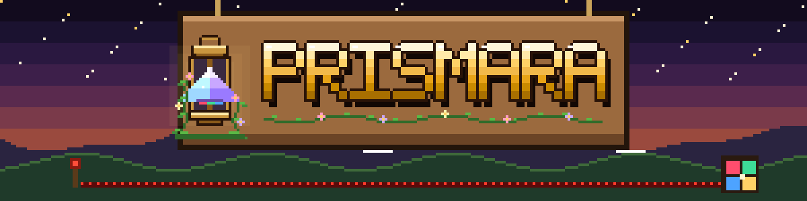
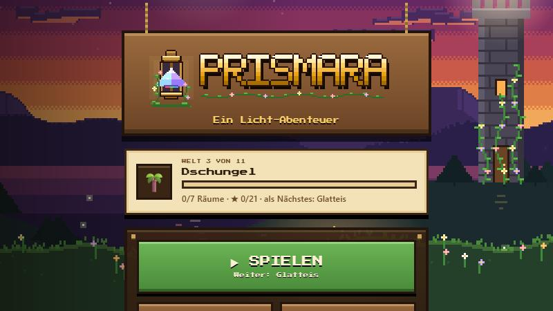
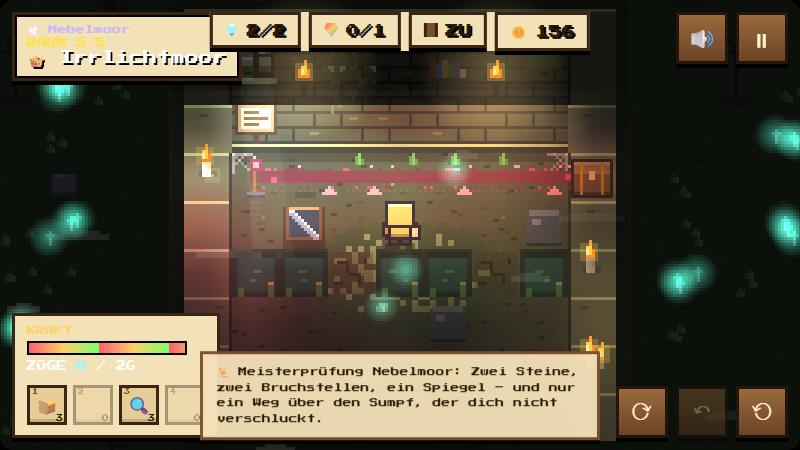
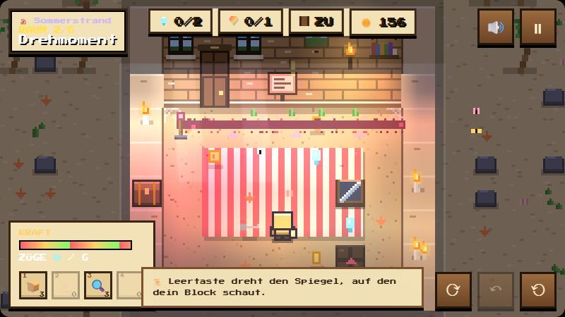
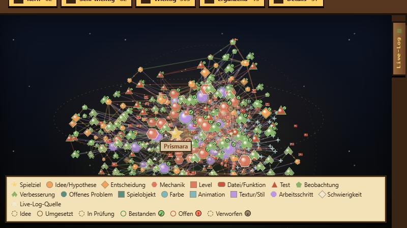

### Ein Escape-Room-Abenteuer mit Redstone-Licht – direkt im Browser

`52 Räume` · `11 Welten` · `Shoppen` · `Tagesrätsel` · `Handy & PC`

---

<table>
<tr>
<td width="50%"></td>
<td width="50%"></td>
</tr>
<tr>
<td width="50%"></td>
<td width="50%"></td>
</tr>
</table>

## 🔦 Worum geht's?

Jeder Raum ist ein Rätsel. Von jeder **Redstone-Fackel** läuft eine Leitung durch den Raum – lenke sie mit Spiegeln, Prismen und Strahlteilern zu den **Redstone-Lampen**. Leuchten alle Lampen in ihrer Farbe, öffnet sich die Tür und es geht in den nächsten Raum.

- **Schieben & drehen:** Kisten, Spiegel und Lampen rücken Feld für Feld, die Leertaste dreht den Spiegel vor dir.
- **Farben mischen:** Rot + Grün = Gelb, Prismen zerlegen Weiß, Farbgläser lassen nur ihre Farbe durch.
- **Jedes Rätsel ist geprüft:** Ein eingebauter Löser (Breitensuche) rechnet jedes Level durch – das Zugziel für ★★★ ist immer das echte Minimum.

## 🗺 Welten

| | Welt | Neu in dieser Welt |
|---|---|---|
| 🏖️ | Sommerstrand | Spiegel schieben und drehen |
| 🌸 | Kirschblüte | Farbfilter, Prisma, Mischlicht |
| 🌴 | Dschungel | Eis, Strahlteiler, Portale |
| 🏰 | Burgverlies | Schlüssel & Gittertore |
| 🌫️ | Nebelmoor | Moorgruben füllen, morsches Holz trägt nur einmal |
| 🌙 | Nachtwald | Wanderlampen, die du trägst |
| 🌋 | Vulkanschmiede | Druckplatten & Kippspiegel |
| 🏜️ | Wüstentempel | Lichtschlösser |
| 🌑 | Schattenreich | Schattenläufer – Licht ist deine Waffe |
| ❄️ | Polarlicht | Farbwandler |
| 🐠 | Korallenriff | Strömungen |

Jede Welt endet mit einer 👑 **Meisterprüfung**.

## 🔓 Freischalten

Du startest im Abenteuer. Mit jedem geschafften Raum öffnen sich neue Modi:

`🗺 Welten` (3 Räume) → `🎨 Held` (5) → `📅 Tagesrätsel` (6) → `🛒 Shoppen` (8)

## 🎮 Steuerung

| PC | Handy |
|---|---|
| `WASD` / Pfeiltasten – laufen & schieben | Steuerkreuz oder Wischen |
| `Leertaste` – drehen | grüner Drehen-Knopf |
| `Z` – Zug zurück · `R` – Raum neu | ↶ / ⟲ |
| `Esc` – Pause | ⏸ |

## 🧠 Gehirn Lab

Prismara ist offen gebaut: Das **Gehirn Lab** zeigt fast 500 Knoten – jede Idee, jedes Level, jede Datei und jede Entscheidung – als 3D-Karte oder Liste, mit Wachstums-Wiedergabe, Farbpaletten und Wichtigkeitsfilter.

## 🛠 Technik

Reine ES-Module ohne Build-Schritt und ohne Abhängigkeiten. Pixel-Renderer mit Minecraft-artigem Licht (Lichtstufen, Schatten, Bloom), Löser per Breitensuche, Levelschmiede für Tagesrätsel.

| Ordner | Inhalt |
|---|---|
| `src/game/` | Regeln, Löser, Levelschmiede, Pixel-Renderer, Welten, Freischalten |
| `src/adventure/` | Escape-Raum, HUD, Handy-Steuerung |
| `src/ui/` | Menü, Tagesrätsel, Shoppen |
| `src/lab/` | Gehirn Lab und 3D-Karte |
| `lab/` | Knoten, Verbindungen und Arbeitsschritte |

Lokal ansehen: `python -m http.server` im Repo-Ordner, dann `http://localhost:8000`.

---

Ein Projekt von **Florian**

Der Quellcode ist öffentlich einsehbar. Eine separate Lizenzdatei ist derzeit nicht enthalten; daraus sollte keine weitergehende Nutzungserlaubnis abgeleitet werden.

